# Segundo Cérebro: Análise de Dados com Python

Repositório de documentação do meu "segundo cérebro" criado no **NotebookLM** para a atividade do bootcamp da DIO.

## 1. Tema e objetivo

- **Tema:** Análise de Dados com Python
- **Objetivo:** criar um professor virtual tira-dúvidas sobre as principais bibliotecas Python para análise de dados e estatística (NumPy, Pandas, Matplotlib, Seaborn e Scikit-Learn).

## 2. Link do notebook compartilhado

[Abrir o notebook no NotebookLM](https://notebook.google.com/notebook/adec07a2-fb50-463a-841e-89daac776f46)

## 3. Fontes que entraram e por que confio nelas

O notebook reúne **29 fontes**, agrupadas abaixo por tema. Priorizei documentação oficial como base e usei livros, vídeos e artigos como apoio didático.

### NumPy

| Fonte | Tipo | Por que confio |
|---|---|---|
| [NumPy documentation — NumPy v2.5 Manual](https://numpy.org/doc/stable/) | Documentação oficial | Mantida pelo próprio projeto, versão atual |
| [NumPy user guide — NumPy v2.5 Manual](https://numpy.org/doc/stable/user/index.html) | Documentação oficial | Cobre arrays, indexação, broadcasting e tipos de dados |
| [NumPy quickstart — NumPy v2.6.dev0 Manual](https://numpy.org/devdocs/user/quickstart.html) | Documentação oficial | Tutorial rápido do próprio projeto |
| [NumPy: the absolute basics for beginners](https://numpy.org/doc/2.5/user/absolute_beginners.html) | Documentação oficial | Guia introdutório oficial |
| [NumPy 1.16 documentation — DevDocs](https://devdocs.io/numpy~1.16/) | Referência de terceiros | Espelho da documentação oficial; versão antiga, usada só como referência complementar |
| [Beginner's Guide to NumPy — Mattermost](https://mattermost.com/blog/beginners-guide-to-numpy/) | Artigo | Apoio didático sobre eficiência de memória |
| [NumPy — Pen and Pants](https://penandpants.com/category/python/numpy/) | Blog técnico | Testes de igualdade em arrays e comparações de desempenho |
| Learn NumPy in 1 hour! | Vídeo (YouTube) | Aula rápida, apoio visual |
| Solving 100 Python NumPy Problems! | Vídeo (YouTube) | Exercícios práticos comentados |

### Pandas

| Fonte | Tipo | Por que confio |
|---|---|---|
| [Getting started tutorials — pandas 3.1.1](https://pandas.pydata.org/docs/getting_started/intro_tutorials/) | Documentação oficial | Passo a passo do próprio projeto |
| [User Guide — pandas 3.1.1](https://pandas.pydata.org/docs/user_guide/index.html) | Documentação oficial | Manual completo: estruturas, E/S, pivot tables, séries temporais |
| Complete Python Pandas Data Science Tutorial! (Keith Galli) | Vídeo (YouTube) | Prática com dados reais |
| Learn Pandas in 1 hour! (Bro Code) | Vídeo (YouTube) | Aula didática de Series e DataFrames |

### Matplotlib

| Fonte | Tipo | Por que confio |
|---|---|---|
| [Tutorials — Matplotlib 3.11.2](https://matplotlib.org/stable/tutorials/index.html) | Documentação oficial | Ciclo de vida de gráficos e estilos |
| [Using Matplotlib — Matplotlib 3.11.2](https://matplotlib.org/stable/users/index.html) | Documentação oficial | Interfaces da biblioteca, Figure e Axes |
| [Curso de Matplotlib e Numpy para Iniciantes (otensor)](https://www.youtube.com/watch?v=QLACZgfUAhY&list=PL5jigOsyxDtBEgO2zUUyf_2LNt3Zenrl6) | Playlist (YouTube) | Em português, cobre subplots e estilização |
| Te ensino TUDO sobre criar gráficos com Python e Matplotlib (Asimov Dados) | Vídeo (YouTube) | Em português, vários tipos de gráfico |
| Matplotlib Full Python Course (NeuralNine) | Vídeo (YouTube) | Integra NumPy e Matplotlib |
| Learn Matplotlib in 1 hour! | Vídeo (YouTube) | Fundamentos em aula rápida |

### Scikit-Learn

| Fonte | Tipo | Por que confio |
|---|---|---|
| [Pipelines and composite estimators — scikit-learn 1.9.1](https://scikit-learn.org/stable/modules/compose.html) | Documentação oficial | Encadeamento de estimadores e transformadores |
| [ColumnTransformer — scikit-learn 1.9.1](https://scikit-learn.org/stable/modules/generated/sklearn.compose.ColumnTransformer.html) | Documentação oficial | Referência da classe |
| [User Guide — scikit-learn 1.9.1](https://scikit-learn.org/stable/user_guide.html) | Documentação oficial | Algoritmos, clustering e seleção de modelos |
| ColumnTransformer and Pipelines in Scikit-Learn (DEV Community) | Artigo | Boas práticas de pré-processamento |
| [Scikit-learn Transformers and Pipelines — Skforecast](https://skforecast.org/0.12.1/user_guides/sklearn-transformers-and-pipeline) | Documentação de biblioteca | Aplicação de transformadores em séries temporais |
| Scikit-Learn Full Crash Course (NeuralNine) | Vídeo (YouTube) | Fluxo completo, da carga à avaliação |

### Livro de referência

| Fonte | Tipo | Por que confio |
|---|---|---|
| [Python Data Science Handbook (versão web)](https://jakevdp.github.io/PythonDataScienceHandbook/) | Livro | Obra de Jake VanderPlas, referência reconhecida na área, disponibilizada pelo autor |
| [Repositório do livro no GitHub](https://github.com/jakevdp/PythonDataScienceHandbook) | Código | Repositório oficial com os notebooks dos exemplos |

### Testes e qualidade de código

| Fonte | Tipo | Por que confio |
|---|---|---|
| [Pytest for Data Scientists — CodeCut](https://codecut.ai/pytest-for-data-scientists/) | Artigo | Pytest aplicado a NumPy e Pandas |
| [How can I write unit tests against code that uses matplotlib? — Stack Overflow](https://stackoverflow.com/questions/27948126/how-can-i-write-unit-tests-against-code-that-uses-matplotlib) | Fórum | Discussão técnica; peso menor, usada como complemento |

## 4. Diretriz de comportamento dada ao notebook

> Você deverá atuar como um agente virtual (professor) de dúvidas relacionados a bibliotecas de análise de dados e estatística para automações. Seu intuito é usar as fontes fornecidas para ensinar o usuário a aplicar alguma funcionalidade das bibliotecas Python, sendo cordial, didático e explicativo.

## 5. Perguntas, respostas e fontes

### Pergunta 1: "Como eu posso extrair dados de uma planilha Excel usando Python?"

**O que o notebook respondeu:** indicou o **Pandas** como biblioteca padrão para isso. Explicou o passo a passo: importar com `import pandas as pd`, carregar o arquivo com `pd.read_excel()`, ler uma aba específica com `sheet_name`, e inspecionar o resultado com `df.head()`, `df.info()` e `df.describe()`. Também avisou que arquivos Excel são mais pesados de processar que CSV ou Parquet em volumes grandes.

**Fontes citadas pelo notebook:**
- *Complete Python Pandas Data Science Tutorial!* (Keith Galli), vídeo do YouTube. O trecho citado explica como importar o pandas como `pd` e apresenta o DataFrame como a principal estrutura de dados da biblioteca ([print da fonte](prints/06-fonte-pergunta1-keith-galli.png)).

**Prints da resposta no chat:**

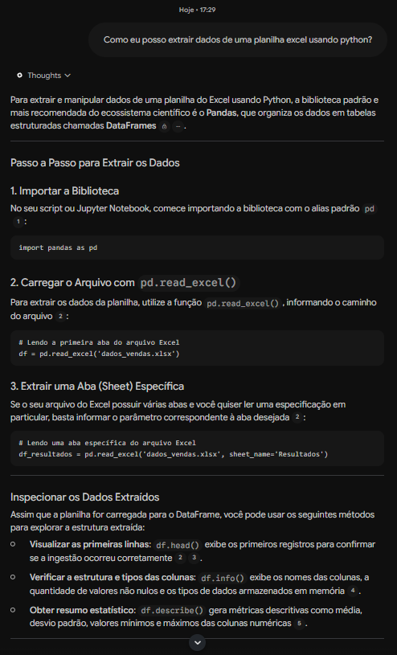

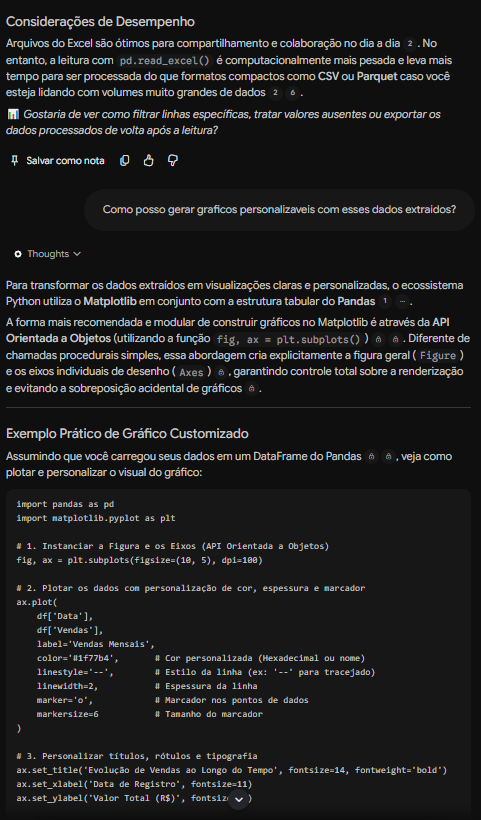

**Prints das fontes citadas:**

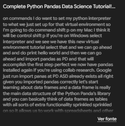

### Pergunta 2: "Como posso gerar gráficos personalizáveis com esses dados extraídos?"

**O que o notebook respondeu:** recomendou o **Matplotlib** com a **API Orientada a Objetos** (`fig, ax = plt.subplots()`), por dar controle explícito de Figure e Axes. Mostrou um exemplo com cor, estilo de linha, espessura e marcador, além de título, rótulos, grade, legenda e `tight_layout()`. Listou recursos de personalização (cores e transparência com `alpha`, marcadores e estilos de linha, `set_title`/`set_xlabel`/`set_ylabel`, estilos prontos com `plt.style.use()`) e citou o **Seaborn** para visualizações estatísticas.

**Fontes citadas pelo notebook:**
- *Getting started tutorials — pandas 3.1.1 documentation* (documentação oficial). O trecho citado mostra o índice dos tutoriais, incluindo "How do I create plots in pandas?" ([print da fonte](prints/07-fonte-pergunta2-pandas-tutorials.png)).
- *Learn Matplotlib in 1 hour!* (vídeo do YouTube). O trecho explica como ajustar o tamanho e a cor dos marcadores, inclusive com valores RGB e hexadecimais ([print da fonte](prints/08-fonte-pergunta2-learn-matplotlib.png)).
- *Matplotlib Full Python Course - Data Science Fundamentals* (NeuralNine, vídeo do YouTube). O trecho mostra como trocar o estilo do marcador (por exemplo, estrelas), definir cores e aplicar transparência ([print da fonte](prints/09-fonte-pergunta2-matplotlib-full-course.png)).

**Prints da resposta no chat:**


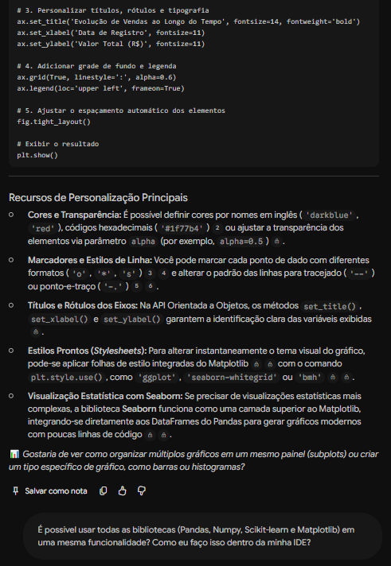

**Prints das fontes citadas:**

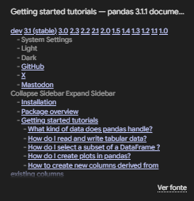

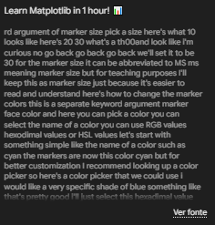

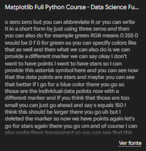

### Pergunta 3: "É possível usar todas as bibliotecas (Pandas, NumPy, Scikit-learn e Matplotlib) em uma mesma funcionalidade? Como eu faço isso dentro da minha IDE?"

**O que o notebook respondeu:** confirmou que é possível e comum, e explicou o papel de cada biblioteca: NumPy (arrays e memória), Pandas (tabelas e limpeza), Scikit-Learn (pré-processamento e modelos) e Matplotlib (visualização). Apresentou um exemplo integrado com `Pipeline` (imputação pela mediana, padronização e regressão logística) seguido de um gráfico de dispersão. Para a IDE, orientou instalar com `pip install numpy pandas scikit-learn matplotlib` e escolher entre scripts `.py` ou notebooks `.ipynb` (VS Code, PyCharm, JupyterLab).

**Fontes citadas pelo notebook:**
- *Scikit-Learn Full Crash Course - Python Machine Learning* (NeuralNine, vídeo do YouTube). O trecho mostra a preparação do ambiente de desenvolvimento e a instalação dos pacotes com `pip` (scikit-learn, numpy, pandas e matplotlib) ([print da fonte](prints/10-fonte-pergunta3-scikit-learn-crash-course.png)).
- *Te ensino TUDO sobre criar gráficos com Python e Matplotlib* (Asimov Dados, vídeo do YouTube). O trecho explica a instalação com `pip install matplotlib`, a execução dentro de um notebook Jupyter e a criação do primeiro gráfico de linha com `plt.plot` e `plt.show` ([print da fonte](prints/11-fonte-pergunta3-asimov-matplotlib.png)).
- *Complete Python Pandas Data Science Tutorial!* (Keith Galli, vídeo do YouTube). O trecho apresenta as duas formas de trabalhar: no navegador, pelo Google Colab, ou localmente em uma IDE como VS Code, PyCharm ou JupyterLab ([print da fonte](prints/12-fonte-pergunta3-keith-galli.png)).

**Prints da resposta no chat:**

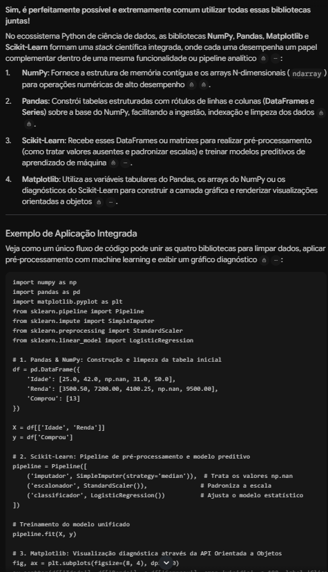

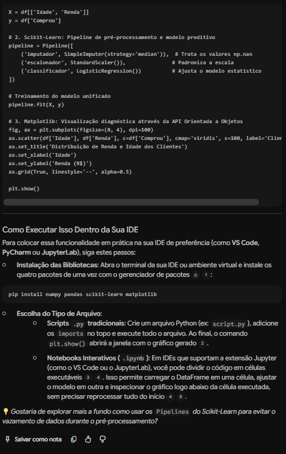

**Prints das fontes citadas:**

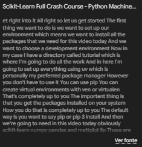

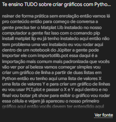

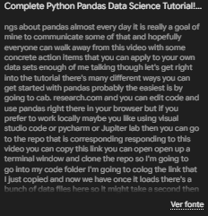

## 6. Mapa mental

Mapa mental gerado pelo NotebookLM a partir das fontes: **Bibliotecas Python para Análise de Dados e Estatística**, com os ramos NumPy, Pandas, Matplotlib, Seaborn e Scikit-Learn.

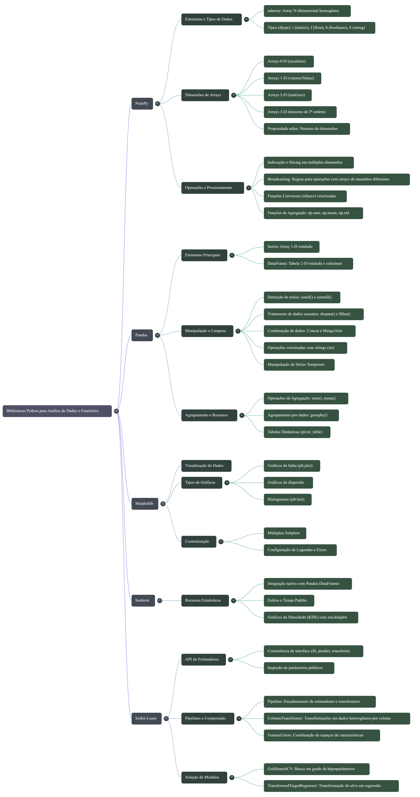

## 7. Estrutura do repositório

```
analise-dados-python-notebooklm/
├── README.md
├── mapa-mental.png
└── prints/
    ├── 01-excel-resposta.png
    ├── 02-excel-desempenho-e-grafico-inicio.png
    ├── 03-grafico-personalizacao.png
    ├── 04-integracao-resposta.png
    ├── 05-integracao-ide.png
    ├── 06-fonte-pergunta1-keith-galli.png
    ├── 07-fonte-pergunta2-pandas-tutorials.png
    ├── 08-fonte-pergunta2-learn-matplotlib.png
    ├── 09-fonte-pergunta2-matplotlib-full-course.png
    ├── 10-fonte-pergunta3-scikit-learn-crash-course.png
    ├── 11-fonte-pergunta3-asimov-matplotlib.png
    └── 12-fonte-pergunta3-keith-galli.png
```
